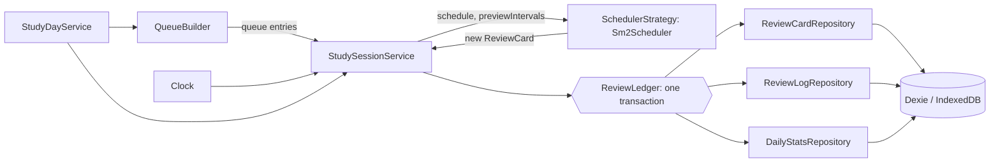

# Lexi Book

Offline-first PWA for learning English vocabulary from the *4000 Essential English Words* books, with a spaced-repetition review schedule. Production: https://english.mhkarami97.ir

The app name is a single constant in `src/config/app.ts`.

## Setup

Dependencies are intentionally not pinned in `package.json`. Install the latest versions yourself so `package-lock.json` is generated on your machine:

```bash
npm i vue vue-router pinia dexie fuse.js @lucide/vue
npm i -D vite @vitejs/plugin-vue typescript vue-tsc tailwindcss @tailwindcss/vite vite-plugin-pwa workbox-window eslint @eslint/js typescript-eslint eslint-plugin-vue eslint-config-prettier globals prettier @types/node vazirmatn @fontsource-variable/source-serif-4 vitest @vue/test-utils fake-indexeddb happy-dom
npm run fonts
```

If npm reports a peer conflict between `pinia` and `vue-router`, install `pinia@^3`. If `vue-tsc` does not yet support your TypeScript major version, install `typescript@^5` or `^6`. Commit `package-lock.json` afterwards; CI uses `npm ci`.

## Scripts

| Script | Purpose |
|---|---|
| `npm run dev` | Vite dev server |
| `npm run build` | Typecheck, production build, `404.html` SPA fallback |
| `npm run preview` | Serve the production build locally (use this to test the service worker) |
| `npm run lint` | ESLint |
| `npm run typecheck` | `vue-tsc --noEmit` |
| `npm test` | Vitest (`happy-dom`, `fake-indexeddb`) |
| `npm run fonts` | Copy self-hosted fonts and licenses into `public/fonts` |

## Architecture



Layers: `domain` (entities, pure scheduling and calendar logic, ports), `data` (Dexie, repositories, importer, backup), `application` (use-cases and the study session), `infrastructure` (audio, search index, clock, storage), `presentation` (views, components, composables, Pinia stores). Patterns: Repository, Adapter (`BookDataAdapter`), Facade (`AudioPlayer`), Strategy (`SchedulerStrategy`), ContentPack, Unit of Work (`ReviewLedger`), and a composition root in `src/container.ts`.

## Study algorithm

Scheduling is SuperMemo SM-2 ([original description](http://super-memory.com/english/ol/sm2.htm), [Anki manual](https://docs.ankiweb.net/manual/deck-options) for the surrounding concepts). `Sm2Scheduler` is pure: it receives the card, the rating and the current time, and returns a new card.

- The ease factor starts at 2.5 and never goes below 1.3.
- On every answer `EF' = EF + (0.1 - (5 - q) * (0.08 + (5 - q) * 0.02))`. The ease is updated before the new interval is computed, as step 5 of the original text says.
- A grade below 3 resets the repetition count and returns the interval to 1 day. The ease keeps its updated value; it is not reset to 2.5.
- Otherwise the intervals are 1 day, then 6 days, then `previous interval * EF`, **rounded up** (the original text says "round it up").
- A lapse is counted when a card in the `review` state is answered Again. Failing a new or already relearning card does not add a lapse.
- If the clock moves backwards, a card is never scheduled before its last review.

### Buttons to quality grades

The only place that maps buttons to grades is `src/domain/scheduling/ratingMap.ts`.

| Button | q | SM-2 meaning | Ease change from 2.5 |
|---|---|---|---|
| Again | 1 | incorrect, but the answer felt familiar | -0.54 |
| Hard | 3 | correct with serious difficulty | -0.14 |
| Good | 4 | correct after a hesitation | 0 |
| Easy | 5 | perfect recall | +0.10 |

Pure SM-2 has no separate Hard or Easy interval multiplier, so for the first two repetitions Hard, Good and Easy show the same interval. They diverge later through the ease factor. Anki's own SM-2 variant adds modifiers; this app deliberately does not.

### Study days

A study day starts at `dayRolloverHour` (default 4) in the device time zone (`Intl.DateTimeFormat`). Due times are the start of a study day, so every card due "on day N" becomes available at the same moment. Daylight-saving days are therefore 23 or 25 hours long, which the tests cover for Europe/Amsterdam. Iran has had no daylight saving since 2022, so Asia/Tehran is tested at its fixed +03:30 offset and across the final change in September 2022.

### Daily queue

- Due reviews (oldest due first) are limited by `maxReviewsPerDay` minus the reviews already done today.
- New cards come from `activeUnitIds`, in book order or shuffled with a seedable random source, limited by `newPerDay` minus the new cards already introduced today. Words with a review card are never new again.
- New cards are spread evenly among reviews: after step `i` exactly `floor((i + 1) * new / total)` new cards have been shown.
- "Study more" adds 10 new cards beyond the daily limit, after a confirmation.
- Orphan cards (their word disappeared after a content re-import) are skipped and never deleted.

### In-session repeats

Only Again returns within the session (after 3 other cards), plus Hard once on a brand-new card (after 6). The original SM-2 asks to repeat everything below grade 4 until it reaches 4; this app repeats less, on purpose, so sessions stay short. A repeat does not write a log, does not change the schedule and can be undone. Repeats end when the card is answered Good or Easy.

The remaining queue is saved after every answer (`studySession` setting), so a refresh resumes the same session on the same study day. Undo history is not saved across a refresh.

### Review mode and swipes

Swipe gestures stay in the Phase 1 "Known / Unknown" study mode. In review mode they are disabled: a stray swipe would record a rating and move a schedule, and undo is only one tap away but easy to miss.

## Settings

| Setting | Default | Range |
|---|---|---|
| `newPerDay` | 10 | 0-200 |
| `maxReviewsPerDay` | 100 | 0-1000 |
| `dayRolloverHour` | 4 | 0-6 |
| `showIntervalsOnButtons` | true | on/off |
| `activeUnitIds` | all units | any subset |
| `newCardOrder` | `unit-order` | `unit-order`, `random` |
| `skipKnownWords` | true | on/off |
| `autoPlayOnFlip` (Phase 1) | false | on/off |

Study settings are stored as one object under the `studySettings` key and sanitized on every read and write. Changing the rollover hour affects answers given afterwards; existing due times are not rewritten.

## Data model

```ts
this.version(1).stores({
  books: 'id', units: 'id, bookId', words: 'id, bookId, unitId',
  userWordState: 'wordId, bookId, [bookId+knowledge], [bookId+favorite]',
  settings: 'key', importState: 'bookId',
});
this.version(2).stores({
  reviewCards: 'wordId, bookId, unitId, [bookId+dueAt], [bookId+state]',
  reviewLogs: '++id, wordId, reviewedAt, [bookId+reviewedAt]',
  dailyStats: 'dateKey',
});
```

- `ReviewCard` rows are created on a word's first answer, so "new" words are the ones without a row. The state union still contains `new`; it appears as `previousState` in logs.
- The due list is one range query on `[bookId+dueAt]`; it never loads all 4000 cards.
- Each answer (and each undo) is one Dexie transaction over `reviewCards`, `reviewLogs` and `dailyStats` ([Dexie transactions](https://dexie.org/docs/Dexie/Dexie.transaction())).
- Content tables (`books`, `units`, `words`, `importState`) and user tables are separate, so a content re-import never touches progress.

### Migration notes

Version 2 only adds tables, so no upgrade function is needed and version 1 rows stay as they are ([Dexie versioning](https://dexie.org/docs/Version/Version)). A test opens a version 1 database and checks that known marks, favorites and settings survive.

Interaction with the Phase 1 "known / unknown" marks:

- With `skipKnownWords` on, words marked known are not introduced as new cards. Words marked unknown are introduced normally.
- Marking a word known later does not delete an existing review card, and unmarking it does not create one.
- "Reset all review progress" clears cards, logs and daily statistics, but not word marks. "Reset word marks" clears marks, but not the review schedule.

## Progress export format

Settings > Back up your progress. The file is JSON; only user data is exported, never book content.

```json
{
  "format": "lexi-book-progress",
  "version": 1,
  "exportedAt": 1790000000000,
  "appVersion": "0.2.0",
  "data": {
    "reviewCards": [], "reviewLogs": [], "dailyStats": [],
    "userWordStates": [], "settings": []
  }
}
```

Import validates the whole file first and rejects it on the first invalid record (wrong format, newer version, malformed entry). Then you choose:

- **Merge**: the newer card or word state wins (by last review or update time), logs are de-duplicated by word and time, daily counters take the larger value, existing settings are kept.
- **Replace**: all user data is deleted first, then the file is written.

After the first completed review session the app calls `navigator.storage.persist()` once; the result is shown in Settings > Storage.

## Content layout

```
public/data/books.json
public/data/<book>/data.json
public/data/<book>/audio/<sound>
public/data/<book>/images/<image>
```

Content is committed to this repository. It is never precached; `data.json` uses StaleWhileRevalidate, and audio/images use bounded CacheFirst caches (audio with range-request support).

## Icons

Place `icon-192.png`, `icon-512.png` and `maskable-512.png` in `public/icons/`. No icons are generated by the project.

## Deployment

1. Repository Settings -> Pages -> Source = GitHub Actions.
2. Custom domain = `english.mhkarami97.ir` and enable Enforce HTTPS.
3. DNS: `CNAME` record `english` pointing to `mhkarami97.github.io`.
4. Pushes to `main` run lint, typecheck, tests, build and deploy (`.github/workflows/deploy.yml`).

`robots.txt` is advisory: it asks well-behaved crawlers to skip `/data/`, but does not protect the files.
