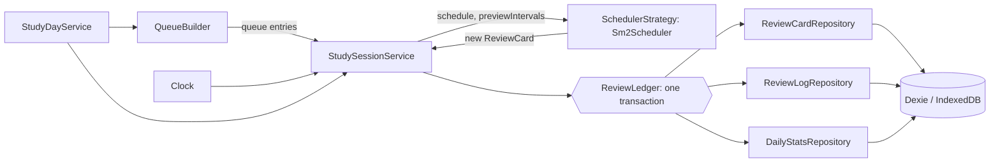
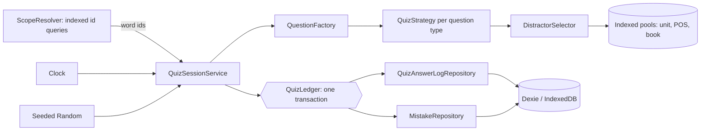
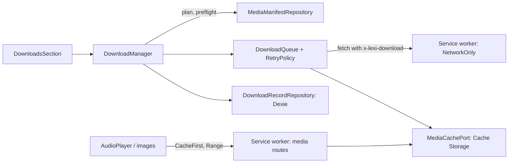

# Easy Learn

Offline-first PWA for learning English vocabulary from the *4000 Essential English Words* books, with a spaced-repetition review schedule, practice modes and optional offline audio and pictures. Production: https://english.mhkarami97.ir

The app name is a single constant in `src/config/app.ts`.

## Setup

Dependencies are intentionally not pinned in `package.json`. Install the latest versions yourself so `package-lock.json` is generated on your machine:

```bash
npm i vue vue-router pinia dexie fuse.js @lucide/vue
npm i -D vite @vitejs/plugin-vue typescript vue-tsc tailwindcss @tailwindcss/vite vite-plugin-pwa workbox-window workbox-core workbox-precaching workbox-routing workbox-strategies workbox-expiration workbox-cacheable-response workbox-range-requests eslint @eslint/js typescript-eslint eslint-plugin-vue eslint-config-prettier globals prettier @types/node vazirmatn @fontsource-variable/source-serif-4 vitest @vue/test-utils fake-indexeddb happy-dom
npm run fonts
```

The `workbox-*` packages (other than `workbox-window`) are imported by the service worker in `src/sw.ts`. Keep them on the same major version as `workbox-window`.

If npm reports a peer conflict between `pinia` and `vue-router`, install `pinia@^3`. If `vue-tsc` does not yet support your TypeScript major version, install `typescript@^5` or `^6`. Commit `package-lock.json` afterwards; CI uses `npm ci`.

## Scripts

| Script | Purpose |
|---|---|
| `npm run dev` | Vite dev server |
| `npm run build` | Typecheck, production build, `404.html` SPA fallback |
| `npm run preview` | Serve the production build locally (use this to test the service worker) |
| `npm run lint` | ESLint |
| `npm run typecheck` | `vue-tsc --noEmit` |
| `npm test` | Vitest (`happy-dom`, `fake-indexeddb`) |
| `npm run fonts` | Copy self-hosted fonts and licenses into `public/fonts` |

## Architecture



Practice flow:



Download flow:



Layers: `domain` (entities, pure scheduling, calendar, quiz and download logic, ports), `data` (Dexie, repositories, importer, backup, Cache Storage adapter), `application` (use-cases and sessions), `infrastructure` (audio, search index, clock, random, storage, media probe, install prompt), `presentation` (views, components, composables, Pinia stores). Patterns: Repository, Adapter (`BookDataAdapter`, `CacheStorageAdapter`), Facade (`AudioPlayer`), Strategy (`SchedulerStrategy`, `QuizStrategy`, `RetryPolicy`), Factory (`QuestionFactory`), ContentPack, Unit of Work (`ReviewLedger`, `QuizLedger`), ports for the media cache, locator, manifest and records, and a composition root in `src/container.ts`.

## Study algorithm (spaced repetition)

Scheduling is SuperMemo SM-2 ([original description](http://super-memory.com/english/ol/sm2.htm), [Anki manual](https://docs.ankiweb.net/manual/deck-options) for the surrounding concepts). `Sm2Scheduler` is pure: it receives the card, the rating and the current time, and returns a new card.

- The ease factor starts at 2.5 and never goes below 1.3.
- On every answer `EF' = EF + (0.1 - (5 - q) * (0.08 + (5 - q) * 0.02))`, computed before the new interval, as step 5 of the original text says.
- A grade below 3 resets the repetition count and returns the interval to 1 day. The ease keeps its updated value.
- Otherwise the intervals are 1 day, then 6 days, then `previous interval * EF`, **rounded up** (the original text says "round it up").
- A lapse is counted when a card in the `review` state is answered Again.
- If the clock moves backwards, a card is never scheduled before its last review.

| Button | q | Meaning | Ease change from 2.5 |
|---|---|---|---|
| Again | 1 | incorrect, but the answer felt familiar | -0.54 |
| Hard | 3 | correct with serious difficulty | -0.14 |
| Good | 4 | correct after a hesitation | 0 |
| Easy | 5 | perfect recall | +0.10 |

The mapping lives in `src/domain/scheduling/ratingMap.ts`. Pure SM-2 has no Hard or Easy interval multipliers, so for the first two repetitions the three passing buttons show the same interval.

A study day starts at `dayRolloverHour` (default 4) in the device time zone. Due times are the start of a study day, so daylight-saving days are 23 or 25 hours long (tested for Europe/Amsterdam; Iran has had no daylight saving since 2022).

Daily queue: due reviews oldest first up to `maxReviewsPerDay` minus those done today; new cards from `activeUnitIds` up to `newPerDay` minus those introduced today, spread evenly among the reviews. Only Again returns within a session (after 3 cards), plus Hard once on a brand-new card (after 6). Swipes are disabled in review mode because a stray swipe would record a rating.

## Practice (quizzes)

Modes: meaning match, picture quiz, fill the blank (choice and typing), dictation, mixed, timed challenge, matching game, mistakes practice, and a placement test. Questions are generated from the existing book data only, in small batches, and the next question is prepared while the current one is answered.

### Quiz results never change SM-2 schedules

SM-2 ratings are self-assessed recall. A multiple-choice answer is an objective result that can be guessed. Mixing the two would corrupt the schedule data, so the quiz code has no access to the review cards, the review ledger or the scheduler (see `src/container.ts`). A wrong quiz answer only creates or updates a Mistake and appends a quiz log. This is deliberate and there is no setting to change it.

### How questions are built

- **Distractors** come from indexed queries, at most 40 rows from a random window per tier: same unit and part of speech, same unit, neighboring units (two either side) with the same part of speech, neighboring units, the whole book with the same part of speech, the whole book. A candidate is rejected when its word contains the answer or the reverse, when a definition option contains the answer word, when its label duplicates an option already chosen, or when its definition is nearly identical: the overlap of meaningful words (stop words removed) is at least 60% (Jaccard). The selector returns exactly the requested number of options or throws `DistractorPoolTooSmallError`; such a word is simply skipped.
- **Cloze** uses the highlighted part of the example sentence as the blank, trimmed. If the highlighted form differs from the headword (a plural, for example), typing accepts both and reports the headword as "close, check the form"; choice questions skip those words. Words whose example has no highlight are skipped.
- **Typed answers** are normalized (trim, lowercase, collapsed spaces, Unicode apostrophes and hyphens). An exact match is correct. With typo tolerance on (default), one wrong letter in a word of five or more letters is "almost": it counts as correct and shows the right spelling.
- **Mistakes** are created on a wrong answer. In mistakes practice, two correct answers in a row remove the mistake; a wrong answer resets the streak.
- **Missing media**: before a picture or dictation question is shown, the app checks whether the file is cached or reachable. If not, that question type is excluded for that word, the session continues, and the summary says how many were skipped.
- **Sessions** are saved after every answer and resume after a refresh. A timed challenge continues with the time left at the last answer; the clock is paused while the tab is hidden ([Page Visibility API](https://developer.mozilla.org/docs/Web/API/Page_Visibility_API)).

### Placement test (a rough estimate)

Four random definition-to-word questions per unit, asked in book order. The run stops once two consecutive units together score below 50%, or when all units are done. The estimated start unit is the first unit where it (together with the next evaluated unit) falls below 50%; if everything passes, it is the last unit. Confidence is low under 12 answers, medium under 30, high above that.

Limits: with four questions per unit, one guess or slip moves a unit by 25 points, multiple choice allows guessing, and only definition recognition is tested. Nothing is applied until you confirm. "Start from Unit X" sets the active units; "Also mark earlier words as known" shows the exact number of words that will change and asks for confirmation. One Undo restores the previous active units and word marks. Placement answers are not written to the mistakes queue.

## Offline use and downloads

The words, units and your progress are stored in IndexedDB after the first import, so studying works offline from then on. Audio and pictures are separate: they are fetched when first used, or downloaded ahead of time per unit in Settings > Offline audio and pictures.

### What is stored where

| Request | Strategy | Cache |
|---|---|---|
| App shell (built files) | Precache; any navigation gets `/index.html`, except `/data/` and file requests | Workbox precache |
| Audio | Download cache first (supports `Range`, so seeking works); a miss goes to the network and is not stored | `lexi-media-v1` |
| Images | Download cache first, then CacheFirst with at most 400 entries for 30 days, purged on quota errors | `lexi-img-opportunistic-v1` |
| `books.json`, `data.json`, `media-manifest.json` | NetworkFirst with a 4 second timeout | `lexi-content-v1` |
| Requests with the `x-lexi-download` header | NetworkOnly (the app's own downloads, so they are not cached twice) | none |

`lexi-media-v1` has no expiration plugin: only the user removes what was downloaded. On activation the service worker deletes caches that start with `lexi-` and are no longer in use. A new app version waits for the user (Reload or Later); nothing activates behind their back.

### Media manifest

The `mediaManifest` Vite plugin writes `media-manifest.json` for each book at build time: a content version, the hash of `data.json`, and for each unit its files with path, kind, size in bytes and the first 16 hex characters of the SHA-256. The app uses it to show sizes before downloading, to verify each file, and to see which files changed.

### How a download works

- `DownloadManager` plans first (what is missing or changed), then checks the free space from `navigator.storage.estimate()`: 20% is kept as a safety margin because the figure is only an estimate, and anything above 50 MB asks for confirmation.
- Up to 4 files are fetched at once. The body streams straight into Cache Storage and is never held in memory.
- A file is accepted only if `Content-Length` and the counted bytes match the manifest; otherwise it is deleted and counted as failed.
- Network errors, 408, 429 and 5xx are retried up to 4 attempts with exponential backoff and full jitter (base 400 ms, cap 10 s). Other 4xx errors and a full disk are not retried.
- Pause aborts the running requests and puts them back at the front of the queue. Stop keeps what was finished. When the device runs out of space the download stops and finished files are kept.
- Persistent storage is requested when a download starts. It lowers the risk of the browser clearing the files but does not remove it.
- Download records (`downloadRecords` in Dexie) hold only a status per unit: none, partial or complete, with file counts. They are derived from what is really in the cache and corrected whenever the Downloads section opens.

### When content changes

If a background refresh imports changed text, `ContentMaintenanceService` runs. Review cards and mistakes whose word no longer exists leave the active tables and wait in a stash (up to 500 of each), and return if the word comes back; review history, daily statistics and word marks are never touched. Cached media that the new manifest no longer lists is removed, and records are recalculated: a unit whose files changed becomes partial, and downloading it again fetches only those files.

### Install and backup reminder

Settings shows an Install button where the browser offers one (Chromium) and Share-sheet instructions in Safari on iPhone and iPad. Because all progress lives on the device, a banner suggests a backup 14 days after the latest of: the first review, the last export, or the last time the banner was dismissed.

## Settings

| Setting | Default | Range |
|---|---|---|
| `newPerDay` | 10 | 0-200 |
| `maxReviewsPerDay` | 100 | 0-1000 |
| `dayRolloverHour` | 4 | 0-6 |
| `showIntervalsOnButtons` | true | on/off |
| `activeUnitIds` | all units | any subset |
| `newCardOrder` | `unit-order` | `unit-order`, `random` |
| `skipKnownWords` | true | on/off |
| `autoPlayOnFlip` | false | on/off |
| `quizQuestionCount` | 10 | 3-100 |
| `quizOptionCount` | 4 | 3-6 |
| `timedChallengeSeconds` | 60 | 15-300 |
| `typoTolerance` | true | on/off |
| `showHints` | true | on/off |
| `quizAutoPlayAudio` | true | on/off |
| `quizAutoAdvance` | true | on/off |

Settings are stored as objects (`studySettings`, `quizSettings`) and sanitized on every read and write.

## Data model

```ts
this.version(1).stores({
  books: 'id', units: 'id, bookId', words: 'id, bookId, unitId',
  userWordState: 'wordId, bookId, [bookId+knowledge], [bookId+favorite]',
  settings: 'key', importState: 'bookId',
});
this.version(2).stores({
  reviewCards: 'wordId, bookId, unitId, [bookId+dueAt], [bookId+state]',
  reviewLogs: '++id, wordId, reviewedAt, [bookId+reviewedAt]',
  dailyStats: 'dateKey',
});
this.version(3).stores({
  words: 'id, bookId, unitId, *posTags',
  quizSessions: 'id, startedAt, mode',
  quizAnswerLogs: '++id, sessionId, wordId, answeredAt',
  mistakes: 'wordId, lastWrongAt',
  placementResults: 'id, bookId, takenAt',
}).upgrade(/* fills words.posTags from words.pos */);
this.version(4).stores({
  downloadRecords: 'unitId, bookId, status',
});
```

- `QuizSession`, `QuizAnswerLog` (append-only), `Mistake` and `PlacementResult` follow the Phase 3 specification.
- Version 3 adds a multi-entry index on `posTags` so distractor pools can be found by part of speech. The upgrade computes `posTags` for words already stored, because an unchanged content hash never triggers a re-import. All other tables are untouched ([Dexie versioning](https://dexie.org/docs/Version/Version), [upgrade](https://dexie.org/docs/Version/Version.upgrade())).
- Version 4 only adds `downloadRecords`, so it needs no upgrade function and every existing row stays as it is. The audio and image bytes are not in IndexedDB; they live in Cache Storage.
- Each quiz answer writes its log and its mistake update in one transaction ([Dexie transactions](https://dexie.org/docs/Dexie/Dexie.transaction())).
- Content tables and user tables are separate, so a content re-import never touches progress.

### Migration notes

Versions 2, 3 and 4 only add tables or indexes; rows from earlier versions stay as they are. With the Phase 1 "known / unknown" marks: `skipKnownWords` skips known words for new cards; marking a word known later does not delete its review card. "Reset all review progress" does not touch quiz data, and "Reset word marks" does not touch the schedule.

## Progress export format

Settings > Back up your progress. Only user data is exported, never book content.

```json
{
  "format": "lexi-book-progress",
  "version": 2,
  "exportedAt": 1790000000000,
  "appVersion": "0.2.0",
  "data": {
    "reviewCards": [], "reviewLogs": [], "dailyStats": [],
    "userWordStates": [], "settings": [],
    "quizSessions": [], "quizAnswerLogs": [], "mistakes": [], "placementResults": []
  }
}
```

Version 1 files (Phase 2) are still accepted; the quiz lists are then empty. Import validates the whole file first and rejects it on the first invalid record. **Merge** keeps the newer card, word state or mistake and de-duplicates logs; **Replace** deletes all user data first. Downloaded media and download records are not part of a backup; download again after restoring on a new device.

## Content layout

```
public/data/books.json
public/data/<book>/data.json
public/data/<book>/audio/<sound>
public/data/<book>/images/<image>
(build output) data/<book>/media-manifest.json
```

Content is committed to this repository. It is never precached. See "Offline use and downloads" for how each kind of file is cached.

## Icons

Place `icon-192.png`, `icon-512.png` and `maskable-512.png` in `public/icons/`. No icons are generated by the project.

## Deployment

1. Repository Settings -> Pages -> Source = GitHub Actions.
2. Custom domain = `english.mhkarami97.ir` and enable Enforce HTTPS.
3. DNS: `CNAME` record `english` pointing to `mhkarami97.github.io`.
4. Pushes to `main` run lint, typecheck, tests, build and deploy (`.github/workflows/deploy.yml`).

`robots.txt` is advisory: it asks well-behaved crawlers to skip `/data/`, but does not protect the files.
