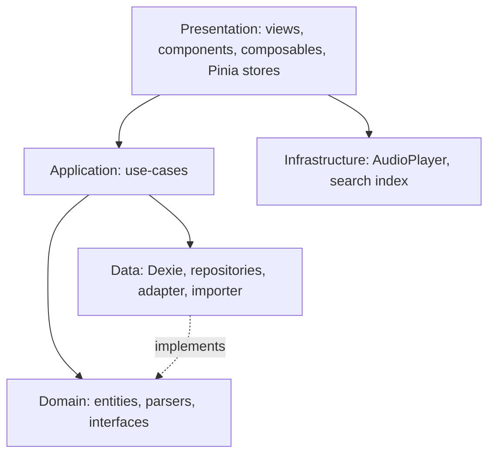

# Lexi Book

Offline-first PWA for learning English vocabulary from the *4000 Essential English Words* books. Production: https://english.mhkarami97.ir

The app name is a single constant in `src/config/app.ts`.

## Setup

Dependencies are intentionally not pinned in this commit. Install the latest versions yourself so `package-lock.json` is generated on your machine:

```bash
npm i vue vue-router pinia dexie fuse.js @lucide/vue
npm i -D vite @vitejs/plugin-vue typescript vue-tsc tailwindcss @tailwindcss/vite vite-plugin-pwa workbox-window eslint @eslint/js typescript-eslint eslint-plugin-vue eslint-config-prettier globals prettier @types/node vazirmatn @fontsource-variable/source-serif-4
npm run fonts
```

If npm reports a peer conflict between `pinia` and `vue-router`, install `pinia@^3`. If `vue-tsc` does not yet support your TypeScript major version, install `typescript@^5` or `^6`.

Commit `package-lock.json` afterwards; CI uses `npm ci`.

## Scripts

| Script | Purpose |
|---|---|
| `npm run dev` | Vite dev server |
| `npm run build` | Typecheck, production build, `404.html` SPA fallback |
| `npm run preview` | Serve the production build locally (use this to test the service worker) |
| `npm run lint` | ESLint |
| `npm run typecheck` | `vue-tsc --noEmit` |
| `npm run fonts` | Copy self-hosted fonts and licenses into `public/fonts` |

## Architecture



Patterns: Repository, Adapter (`BookDataAdapter`), Facade (`AudioPlayer`), ContentPack, and a `SchedulerStrategy` interface reserved for Phase 2.

## Content layout

```
public/data/books.json
public/data/<book>/data.json
public/data/<book>/audio/<sound>
public/data/<book>/images/<image>
```

Content is committed to this repository. It is never precached; `data.json` uses StaleWhileRevalidate, and audio/images use bounded CacheFirst caches (audio with range-request support).

## Icons

Place `icon-192.png`, `icon-512.png` and `maskable-512.png` in `public/icons/`. No icons are generated by the project.

## Deployment

1. Repository Settings -> Pages -> Source = GitHub Actions.
2. Custom domain = `english.mhkarami97.ir` and enable Enforce HTTPS.
3. DNS: `CNAME` record `english` pointing to `mhkarami97.github.io`.
4. Pushes to `main` run lint, typecheck, build and deploy (`.github/workflows/deploy.yml`).

`robots.txt` is advisory: it asks well-behaved crawlers to skip `/data/`, but does not protect the files.
